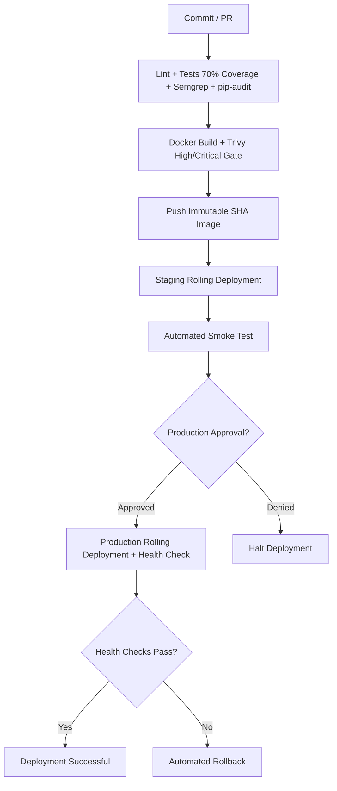

# Kubernetes CI/CD Orchestration Platform
This project delivers a cloud-native, high-availability microservice by packaging a lightweight Flask application into a production-grade Kubernetes environment, entirely managed by an automated GitHub Actions CI/CD pipeline

The architecture is built on three core pillars:
- Lightweight Application Layer: A minimal, secure Flask API served by Gunicorn and built using multi-stage Docker images to minimize the attack surface and optimize container startup speeds.
- Production-Grade CI/CD: A fully automated GitHub Actions pipeline that triggers on code changes, runs static analysis, builds secure OCI container images, and manages Zero-Downtime deployments.
- Resilient Kubernetes Orchestration: A declarative infrastructure configuration running multiple replicas with active rolling updates, strict hardware resource boundaries, and automated self-healing via health probes.

For a quick start, please start here:[Quick Start](./start-here.md)

## Pipeline




  

The workflow runs checks on pull requests. Pushes to `main` build and push

`REGISTRY_USERNAME/sec-project:<git-sha>`, deploy staging, and then wait for the

GitHub `production` environment approval before production deployment.

  

## Setup

  

Local checks:

  

```bash

python  -m  venv  .venv && source  .venv/bin/activate

pip  install  -r  requirements-dev.txt

ruff  check  . && ruff  format  --check  . && pytest

```

  

Run locally with `python app.py`, or build with `docker build -t sec-project .`.

  

Configure these GitHub repository secrets: `REGISTRY_USERNAME`, `REGISTRY_TOKEN`,

and base64-encoded `KUBE_CONFIG`. Configure a required reviewer on the

`production` environment for the manual approval gate.

  

## Security and deployment gates

  

The pipeline stops on lint/format errors, failed tests, coverage below 70%,

Semgrep ERROR findings, dependency vulnerabilities, or HIGH/CRITICAL Trivy

findings. Only immutable commit-SHA images are deployed. Kubernetes uses a

rolling update with `maxUnavailable: 0` for zero downtime. `deploy.sh` waits

up to five minutes for rollout and automatically runs `kubectl rollout undo` on

failure; its output is the deployment notification/log.

  

The Kubernetes manifests intentionally use `IMAGE_PLACEHOLDER`; the deployment

script applies the manifest and sets the actual image from the pipeline.